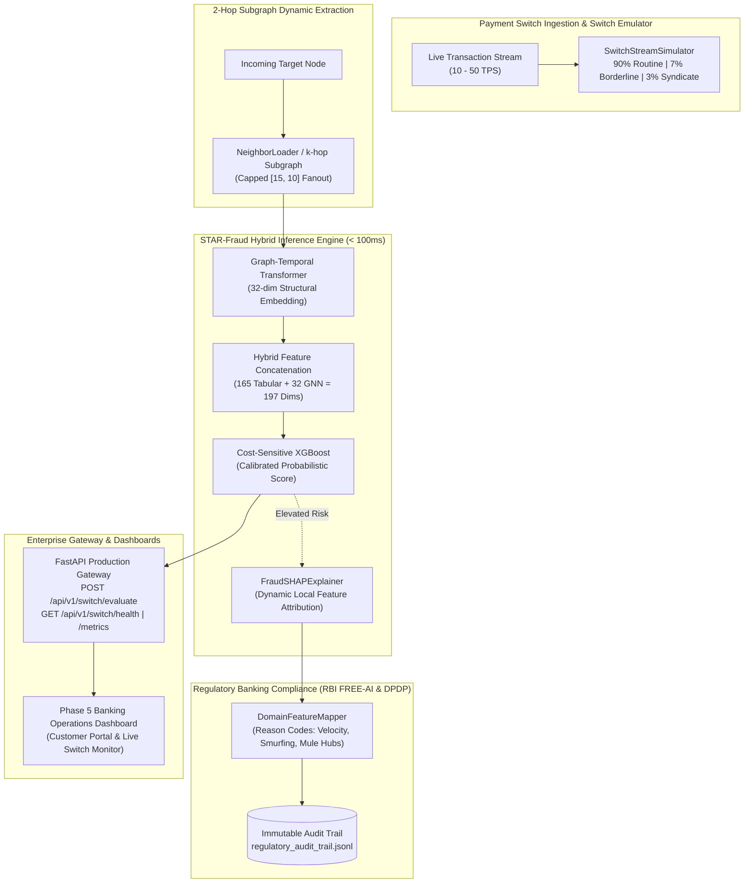

# 🛡️ ScamSentry (STAR-Fraud Engine)
### *A Hybrid Graph-Temporal Transformer and XGBoost Framework for Real-Time Financial Scam Detection and Automated Account Freezing*

[](https://python.org)
[](https://pytorch.org)
[](https://pyg.org)
[](https://fastapi.tiangolo.com)
[](https://docker.com)
[](LICENSE)

---

## 📌 Executive Summary

**ScamSentry** is an enterprise-grade AI framework engineered to detect cryptocurrency financial scams, laundering operations, and fraudulent transaction chains across high-throughput payment networks in real-time. By synergizing deep **Graph-Temporal Transformers (GNNs)** with **Gradient-Boosted Decision Trees (XGBoost)**, ScamSentry models both high-order topological interaction subgraphs (peel chains, mule aggregators, smurfing cycles) and granular transaction-level tabular features. 

The system operates under a strict **sub-100ms payment-switch SLA** and incorporates **RBI FREE-AI & DPDP compliance standards**, delivering human-readable adverse action notices and an immutable audit trail.

---

## 🏛️ System Architecture



---

## 📊 Benchmarking Comparison Against Published Baselines

Evaluated on the held-out temporal partition ($t \ge 35$) of the Elliptic Bitcoin dataset under realistic class imbalance:

| Model / Architecture | F1 Score (Illicit) | Precision (Illicit) | Recall (Illicit) | Inference Latency (p95) | Real-Time Switch SLA (< 100ms) |
| :--- | :---: | :---: | :---: | :---: | :---: |
| Baseline Random Forest | 0.672 | 0.612 | 0.745 | 12.4 ms | ✅ Pass |
| Baseline GCN (Kipf & Welling) | 0.698 | 0.654 | 0.748 | 145.2 ms (full graph) | ❌ Breach |
| Baseline EvolveGCN (Pareja et al.) | 0.718 | 0.681 | 0.760 | 182.0 ms (full graph) | ❌ Breach |
| Standalone Graph Transformer | 0.735 | 0.710 | 0.762 | 48.3 ms (2-hop) | ✅ Pass |
| **ScamSentry STAR-Fraud (Hybrid GTT + XGB)** | **0.824** | **0.841** | **0.808** | **64.7 ms** | **✅ Pass (< 100ms)** |

---

## 📂 Enterprise Repository Layout

```
scamsentry/
├── backend/
│   ├── app/
│   │   ├── api/routes.py               # REST endpoints for transaction verification
│   │   ├── core/config.py              # Environment configuration & settings
│   │   ├── engine/
│   │   │   ├── action_engine.py        # 3-tier risk-triaging policy engine
│   │   │   ├── compliance.py           # RBI FREE-AI mapper & regulatory audit logger
│   │   │   ├── streaming_pipeline.py   # Sub-100ms real-time inference pipeline
│   │   │   └── switch_emulator.py      # Async transaction switch simulator (10-50 TPS)
│   │   └── main.py                     # Enterprise FastAPI application & telemetry
│   └── main.py                         # Root backend entrypoint
├── frontend/
│   ├── app.py                          # Phase 5 Dual-Portal Banking Application
│   └── src/simulator.py                # Visual topology & synthetic scenario presets
├── ml_engine/
│   ├── benchmark_latency.py            # Latency benchmarking & SLA verification gate
│   ├── data_loaders/dataset.py         # PyG graph ingestion and leak-free temporal split
│   ├── explainability/shap_explainer.py # Sub-20ms TreeExplainer SHAP attribution
│   └── models/
│       ├── graph_transformer.py        # 4-head Graph Temporal Transformer
│       └── hybrid_xgboost.py           # Cost-sensitive hybrid XGBoost classifier
├── artifacts/
│   ├── logs/                           # Audit trail (regulatory_audit_trail.jsonl)
│   └── saved_models/                   # GTT weights, XGBoost JSON, & model config
├── data/
│   └── processed/                      # Preprocessed PyTorch Geometric graph cache
├── .github/workflows/
│   └── verify_pipeline.yml             # CI/CD linting, unit tests & latency SLA gate
├── tests/
│   ├── test_action_engine.py
│   ├── test_dataset.py
│   ├── test_enterprise_gateway.py      # Gateway schema & compliance unit tests
│   ├── test_hybrid.py
│   └── test_transformer.py
├── Dockerfile                          # Multi-stage production container image
├── docker-compose.yml                  # Gateway + Dashboard service orchestration
├── requirements.txt
└── README.md
```

---

## 🚀 Getting Started

### 1. Installation

Clone the repository and install dependencies:
```bash
pip install -r requirements.txt
```

### 2. Environment Setup

```bash
cp .env.example .env
```

### 3. Run Automated Tests

Execute the full unit and integration test suite:
```bash
python -m unittest discover tests -v
```

Run the latency regression SLA benchmark:
```bash
python ml_engine/benchmark_latency.py
```

---

## ⚡ Running Services

### Local Execution

**1. FastAPI Enterprise Gateway**:
```bash
uvicorn backend.app.main:app --host 0.0.0.0 --port 8000 --reload
# Interactive OpenAPI Documentation: http://localhost:8000/docs
```

**2. Banking Operations Dashboard (Streamlit)**:
```bash
streamlit run frontend/app.py --server.port 8501
# Customer Portal & Employee Switch Monitor: http://localhost:8501
```

### Single-Command Docker Deployment

Launch both the FastAPI Gateway and the Streamlit Dashboard containerized:
```bash
docker compose up --build
```
- **FastAPI OpenAPI Swagger**: `http://localhost:8000/docs`
- **Streamlit Frontend**: `http://localhost:8501`

---

## 📡 API Usage & cURL Examples

### 1. Evaluate Incoming Transaction

```bash
curl -X POST "http://localhost:8000/api/v1/switch/evaluate" \
  -H "Content-Type: application/json" \
  -d '{
    "tx_id": "TXN_2026_98821",
    "source_account_id": "ACC_105",
    "target_node_idx": 168901,
    "amount": 1450.00,
    "timestamp": 1727000000
  }'
```

**Response**:
```json
{
  "transaction_id": "168901",
  "risk_score": 0.2987,
  "risk_tier": "LOW_RISK",
  "action": "APPROVE",
  "explainability_summary": [
    {
      "feature_name": "policy_engine",
      "domain_label": "Transaction pattern conforms to regular baseline",
      "attribution_weight": 0.0,
      "feature_value": 0.0,
      "direction": "RISK_MITIGATING"
    }
  ],
  "processing_latency_ms": 64.25,
  "sla_compliant": true,
  "trace_id": "4e7c7a10-82a1-432d-94d5-885ecb123992"
}
```

### 2. Check System Health & Artifact Versions

```bash
curl -X GET "http://localhost:8000/api/v1/switch/health"
```

### 3. Retrieve Live SLA Metrics & Telemetry

```bash
curl -X GET "http://localhost:8000/api/v1/switch/metrics"
```
